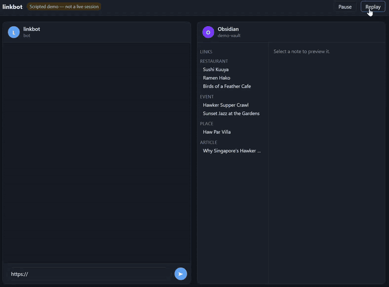

# linkbot

A Telegram bot that saves links from mobile (Instagram, TikTok, web articles), extracts structured data using an LLM, stores entries in Obsidian, and answers natural language queries.

## Demo



[Try the interactive scripted replay](https://alwyn-ong.github.io/linkbot/)

## What it does

1. **Save**: Share any link from mobile via Telegram's share sheet → bot scrapes and extracts structured info
2. **Confirm**: Bot shows extracted data for review before saving; user can correct fields inline
3. **Store**: Each entry is saved as a markdown note with YAML frontmatter in an Obsidian vault
4. **Query**: Ask the bot natural language questions ("Japanese restaurants", "free events this weekend") → bot returns matching entries
5. **Weather-aware suggestions**: For queries about today or tonight and for `/plan`, the bot passes the current data.gov.sg 2-hour forecast and PSI to Gemini. Outdoor places rank higher when the area is clear, indoor places when it's raining or hazy, and each pick says why. If an outdoor pick's area has rain in the forecast, it adds a wet-weather alternative. No API key is needed, and if the weather data is unavailable the bot answers without it

## Architecture

```
mobile share sheet
      ↓
Telegram bot (Python, long-polling)
      ↓
Jina Reader (r.jina.ai/<url>) — page → clean markdown
(Instagram → Playwright, TikTok → yt-dlp)
      ↓
Gemini API (gemini-2.5-flash, falls back to gemini-3.1-flash-lite) — extract structured JSON
      ↓
Obsidian vault — one .md note per entry, YAML frontmatter
      ↑
Telegram query — bot reads vault files → Gemini → formatted response
```

## Note schema

Each entry is a markdown file under `vault/Links/` with frontmatter:

```yaml
---
name: Sushi Jiro
type: restaurant          # restaurant | event | article | place
address: 123 Orchard Rd
hours: 6pm–10pm
date:                     # for events
tags: [japanese, omakase]
price_range: $$
setting: indoor           # indoor | outdoor | both; used for weather ranking
source: https://...
saved: 2026-05-27
---
Free-text notes or description here.
```

## Stack

- **Bot framework**: python-telegram-bot
- **Scraping**: Jina Reader API (free, no key needed); Playwright for Instagram; yt-dlp for TikTok
- **LLM**: Gemini 2.5 Flash via Google AI Studio (free tier), with Flash-Lite fallback on rate limits
- **Weather**: data.gov.sg 2-hour forecast and PSI (no key needed, cached for 15 minutes)
- **Storage**: Obsidian vault (markdown files)
- **Runtime**: local machine (runs when computer is on; Telegram queues messages when offline)

## Setup

```bash
cp .env.example .env
# fill in TELEGRAM_BOT_TOKEN, GEMINI_API_KEY and ALLOWED_USER_ID

python -m venv .venv && source .venv/bin/activate
pip install -r requirements.txt
playwright install chromium
python bot.py
```

## Commands

| Command | Description |
|---|---|
| *(send a link)* | Extract, preview, and save an entry |
| *(send a question)* | Query your saved entries |
| `/list` | Show recently saved entries |
| `/delete <name>` | Remove an entry |
| `/plan` | Multi-turn date planner |
| `/cancel` | Cancel the current flow |

## Environment variables

| Variable | Description |
|---|---|
| `TELEGRAM_BOT_TOKEN` | From @BotFather on Telegram |
| `GEMINI_API_KEY` | From aistudio.google.com |
| `OBSIDIAN_VAULT_PATH` | Absolute path to your Obsidian vault |
| `OBSIDIAN_LINKS_FOLDER` | Subfolder within vault for link notes (default: `Links`) |
| `ALLOWED_USER_ID` | Your numeric Telegram user ID (e.g. from @userinfobot). **Required**: the bot refuses to start without it, since otherwise anyone who finds the bot could use it and spend your Gemini quota |
| `LINKBOT_LOCATION` | City used to disambiguate hours/address lookups (default: `Singapore`) |

## License

MIT, see [LICENSE](LICENSE).
